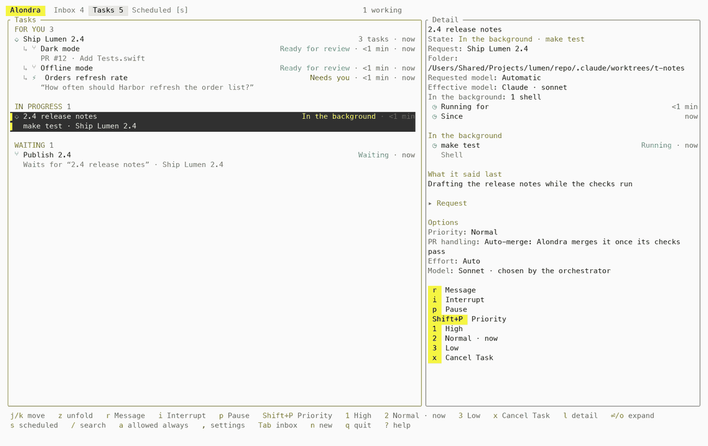
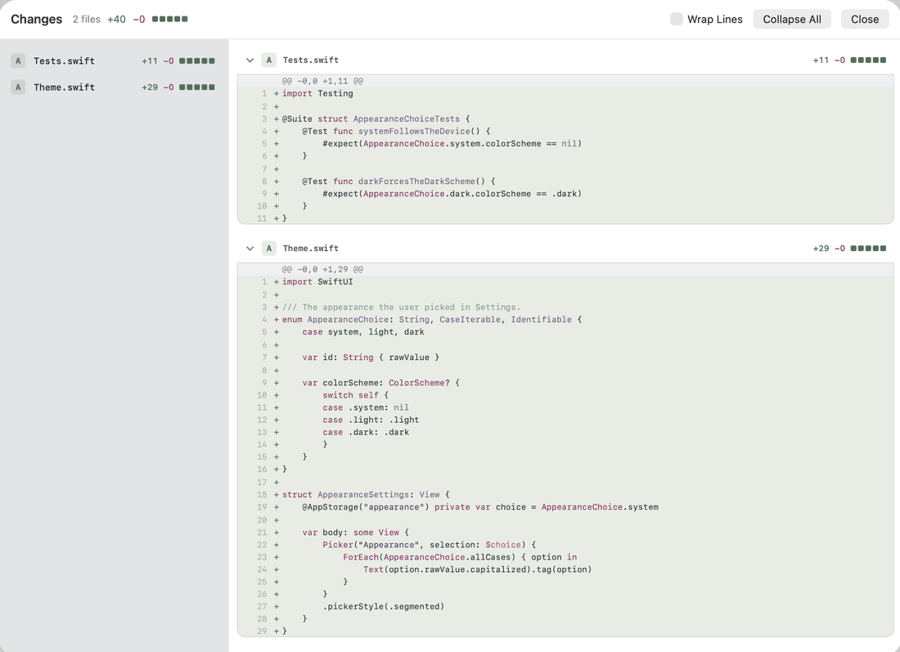
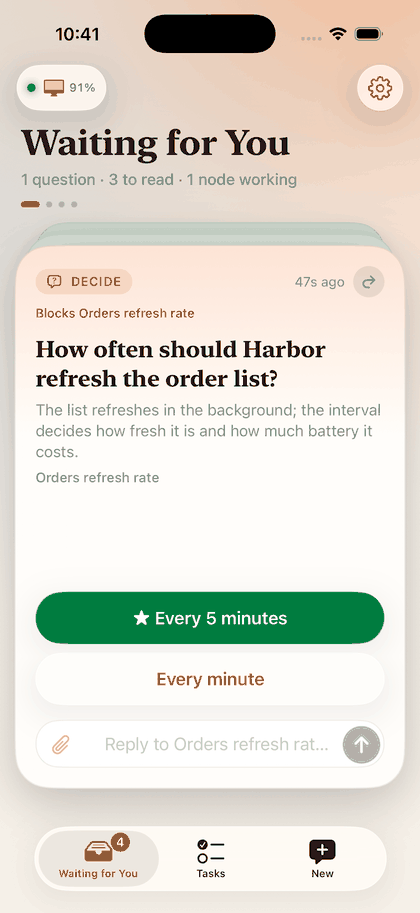

# Alondra

**Run a team of coding agents on your Mac and steer them from your iPhone.**

Alondra is a daemon that runs Claude Code and Codex sessions on your Mac, turns each piece of work
into a task with its own worktree and pull request, and brings every decision to you as a card:
a question, a plan, a permission, a finished pull request. You answer from the terminal, the Mac
app or the iPhone; the agents carry on.

Your agents run on your Mac; Alondra Cloud connects your devices. Teams are coming soon.

<p align="center">
  <picture>
    <source media="(prefers-color-scheme: dark)" srcset="docs/images/tui-tasks-dark.png">
    
  </picture>
</p>

<p align="center">
  <picture>
    <source media="(prefers-color-scheme: dark)" srcset="docs/images/mac-review-dark.png">
    
  </picture>
  <picture>
    <source media="(prefers-color-scheme: dark)" srcset="docs/images/iphone-card-dark.png">
    
  </picture>
</p>

*The terminal, Mac and iPhone apps on a demo sandbox with made-up projects.*

## Install

```bash
brew install bitomule/tap/alondra
alondra
```

`alondra` sets up the rest the first time: your projects folder, the background service and the
Claude Code plugin. Run it again at any time; it only changes what is missing.

You need a Mac on Apple Silicon with macOS 26 or later, and Claude Code, Codex or both, already
installed and signed in. [`INSTALL.md`](INSTALL.md) has the details, the iPhone and Mac apps, and
what to do when something fails.

Before installing, read [what Alondra does on your Mac](docs/on-your-mac.md): installed programs,
files, connections, permissions and credentials, with source links and a prompt you can give an
agent to audit the checkout.

## What it does

1. **You write a request** in the TUI, the Mac app or the iPhone: "add rate limiting to the API".
2. **The orchestrator** reads it, makes a plan and splits it into tasks. A plan that needs your approval comes back to you
   as a card for approval before any code changes.
3. **Each task gets a node**: an agent session in its own git worktree, running Claude Code or
   Codex with your own account. The orchestrator picks the model and the reasoning effort of each
   task, and Alondra runs it on one of your accounts. A task that depends on another waits until
   that one has landed; the rest work in parallel, within what your Mac and your plans allow.
4. **Cards bring you in only when needed.** A node that has a question, wants a plan approved or
   opens a pull request puts one card in front of you. Nothing else interrupts you.
5. **Alondra merges and cleans up.** When you accept a delivery it merges the pull request and
   removes the task's worktree.

By design, every task and node has one visible state, and a task waits only for capacity or for you.
A task that gets stuck anyway is a bug, and fixing those is part of the work.

## How it works

| Piece | What it is |
|---|---|
| `alondrad` | The daemon: runs 24/7 under launchd, keeps the state in SQLite and serves the API |
| Orchestrator | Turns requests into plans and tasks; runs only when there is work, never as an idle process |
| Nodes | One agent session per task, in its own worktree, through the Claude Agent SDK host or Codex |
| Cards | Questions, plans, permissions and deliveries, each decided from the card alone |
| `alondra` | The CLI and TUI, and the MCP server the nodes use to ask you things |
| iPhone and Mac apps | The same cards and tasks, with push notifications |

Only sessions that Alondra launches take part: a Claude session you start in your own terminal has
no plugin, no task and no card. The design, from the daemon's state model to the read side the
screens use, is in [`docs/architecture/overview.md`](docs/architecture/overview.md).

## What is different

- **An orchestrator.** A request becomes a plan, the plan becomes tasks, and each
  task gets its own node in its own worktree. Tasks can depend on each other and wait for one
  another; the ones with nothing between them run at the same time. The plan comes back to you as
  a card to approve before any code is written, when the work asks for one.
- **Deciding and doing stay apart.** You and the orchestrator decide what gets built: only the
  orchestrator creates tasks. A node only does its own task; something it sees outside it goes to
  the orchestrator as a suggestion.
- **Decisions, not conversations.** You never read the agents' conversations. A task shows what
  its agent is doing and the last thing it said, and whatever needs you arrives as a card.
- **An inbox of cards.** Everything that needs you arrives as a card, and a card is one thing: a
  question, a plan, a permission or a finished pull request, with all its context. You decide it
  from the terminal, the Mac app or the iPhone, and the answer reaches the node that asked.
- **The daemon lives on your Mac.** `alondrad` runs your agents, keeps the state and serves your
  devices. The server Alondra Cloud runs is only a control plane (accounts, pairing, push, a
  relay); it is not where work happens. Clients are the terminal UI, the iPhone app and the Mac app.
- **Remote access without a VPN.** Away from home your iPhone reaches your Mac over a direct
  connection when the network allows it, and through the relay when it does not. There is nothing
  to install on either side: no Tailscale, no port forwarding to set up.
- **End-to-end encryption between your devices.** Requests and answers are sealed on one device and
  opened on the other. The relay carries bytes it cannot read.
- **More than one Mac.** Pair your iPhone with each of your Macs and switch between them in the
  app. Using several at once from one screen is coming soon.
- **Review where you are.** Pull request cards open the diff in the iPhone and Mac apps, and in the
  terminal UI in `tuicr` (installed separately).
- **Model and effort per task.** For each task the orchestrator picks a model and a reasoning
  effort from what your connected Claude and Codex accounts offer, and records why. Alondra runs the
  task on one of your accounts that offers that model, in the order you set, passing over any whose
  plan has run out. You can choose the model, the effort and the account yourself instead. A decider
  that learns from the results of past tasks is coming soon.
- **Metrics.** Settings › Metrics on the iPhone and the Mac, `Shift+M` in the TUI and
  `alondra metrics` show how your tasks went, by model and effort and by project: how many were
  done with no rework, the rounds of changes and your interventions, the provider's estimate of
  their cost, tokens, steps, and the time spent working, waiting for you and queued. The
  orchestrator reads the same numbers when it picks a model.
- **MCP servers in one place.** Settings on the Mac and the iPhone lists the MCP servers your agents
  use and what each offers, and lets you remove one you added to your own settings. Authorizing a
  server from a device other than the Mac is coming soon.

### Providers and sign-in

Alondra supports **Claude** (through Claude Code) and **Codex**, alone or together, with several
accounts of each.

Agent sessions use your Claude Code or Codex login. You can use an existing profile or add an
account through the provider's native sign-in. Claude Code owns its tokens; Alondra's Codex
sign-in flow can publish credentials to the selected profile and Keychain. The
[credential inventory](docs/on-your-mac.md#credentials-and-authority) explains those boundaries.

## Alondra Cloud

Alondra Cloud connects your devices: accounts, pairing, push notifications and a
relay for when your iPhone cannot reach your Mac directly. Access opens little by little: join the
waiting list at [getalondra.com](https://getalondra.com).

On the same Wi-Fi your devices connect directly to your Mac, with no account. The
server code is in this repository under the same license.

Either way the work happens on your Mac, and the traffic between your devices is end-to-end
encrypted.

## Privacy

Alondra Cloud is a control plane. It does not run your agents and does not read your work.

What passes through it:

- your account (sign-in identity and email);
- the registry of your devices: device IDs, public keys and the endpoint IDs used to connect them;
- push notification tokens, and the push messages themselves, sealed for each device (a generic
  fallback text is used when a device cannot open them);
- connection metadata the relay sees by necessity: addresses, timing and how many bytes it carried.

What Alondra Cloud cannot read:

- your code, repositories and worktrees;
- task and card contents, plans, diffs, transcripts and attachments, which travel between your
  devices end to end, as sealed envelopes the relay carries without being able to open them;
- your Claude and Codex credentials: local provider profiles and Keychain hold them, and the
  provider tools use them to authenticate directly with their services. See the
  [credential inventory](docs/on-your-mac.md#credentials-and-authority).

How devices talk to a Mac is in [the device protocol](docs/iroh-protocol.md); report anything that looks
wrong under [`SECURITY.md`](SECURITY.md).

## FAQ

**Does it replace Claude Code or Codex?** No. It launches them and adds what they lack across many
sessions: one place for all the questions, a state per task, pull requests and worktrees handled
for you.

**Does my code leave my Mac?** Agents can send it to your providers (Anthropic, OpenAI), GitHub
and the integrations you configure, as if you ran those tools yourself. Alondra Cloud cannot
read your code. See the [connection inventory](docs/on-your-mac.md#connections).

**Do I need an account with Alondra?** Not on the same network. Reaching your Mac from your iPhone
away from home goes through Alondra Cloud.

**Which platforms?** The daemon, CLI and TUI need an Apple Silicon Mac. The apps are for iPhone
and Mac. They are in alpha and come with access to Alondra Cloud: join the waiting list at
[getalondra.com](https://getalondra.com).

**Where are the logs and settings?** In `~/.alondra/`. `alondra doctor` says what works and how to
fix what does not.

## Documentation

- [`INSTALL.md`](INSTALL.md): install, apps, troubleshooting
- [What Alondra does on your Mac](docs/on-your-mac.md): programs, files, connections and an audit prompt
- [`docs/architecture/overview.md`](docs/architecture/overview.md): how the pieces fit
- [The device protocol](docs/iroh-protocol.md): how devices talk to a Mac
- [`docs/building-from-source.md`](docs/building-from-source.md): build it yourself
- [`docs/running-tests.md`](docs/running-tests.md): run the tests

## Contributing

Pull requests go straight to this repository. Read [`CONTRIBUTING.md`](CONTRIBUTING.md) first, and
the [`CODE_OF_CONDUCT.md`](CODE_OF_CONDUCT.md). Bugs and ideas are issues here; hangs and
crashes go to [bitomule/alondra-issues](https://github.com/bitomule/alondra-issues); security
reports go through [`SECURITY.md`](SECURITY.md).

## License

Alondra is released under the [Elastic License 2.0](https://www.elastic.co/licensing/elastic-license)
(ELv2, SPDX `Elastic-2.0`). The full text is in [`LICENSE.md`](LICENSE.md); the notices for the software Alondra
includes are in [`THIRD_PARTY_NOTICES.md`](THIRD_PARTY_NOTICES.md).

- **You may** use it, copy it, modify it and distribute it, for yourself, inside your company or
  for a client.
- **You may not** offer Alondra to others as a hosted or managed service that gives them a substantial
  part of its features.
- For a permission or a commercial license, write to
  [licensing@getalondra.com](mailto:licensing@getalondra.com).

This is source-available, not an OSI-approved open source license.

The Claude Agent SDK that Alondra downloads when it builds is Anthropic's, under Anthropic's own
terms, and is not covered by this license.

### Trademark

"Alondra" and the Alondra logo are not licensed. The license covers the code, not the name or the
logo: forks and derived services must use another name and another logo. A project that builds on Alondra and
uses "Alondra" in its name should say that it is not affiliated with this project.

Copyright 2026 David Collado Sela.
