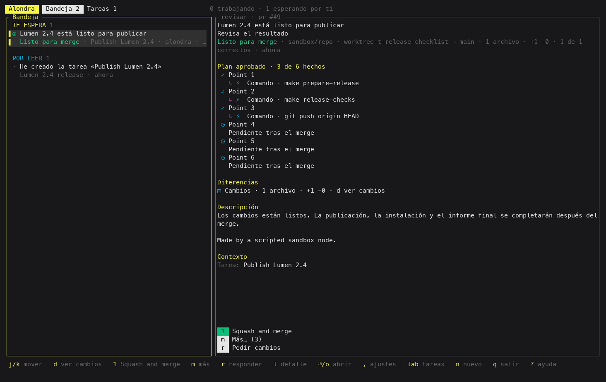
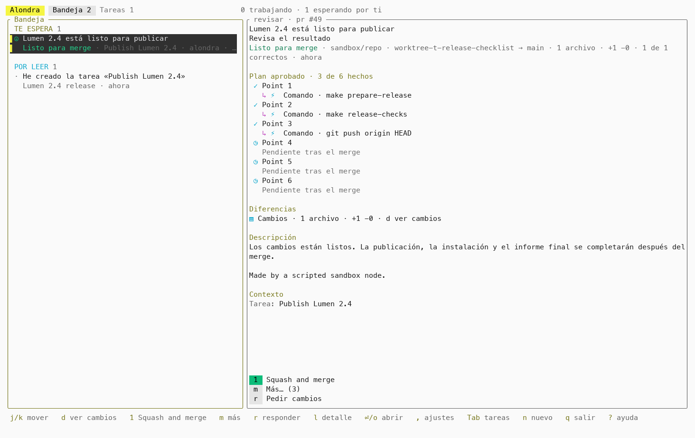
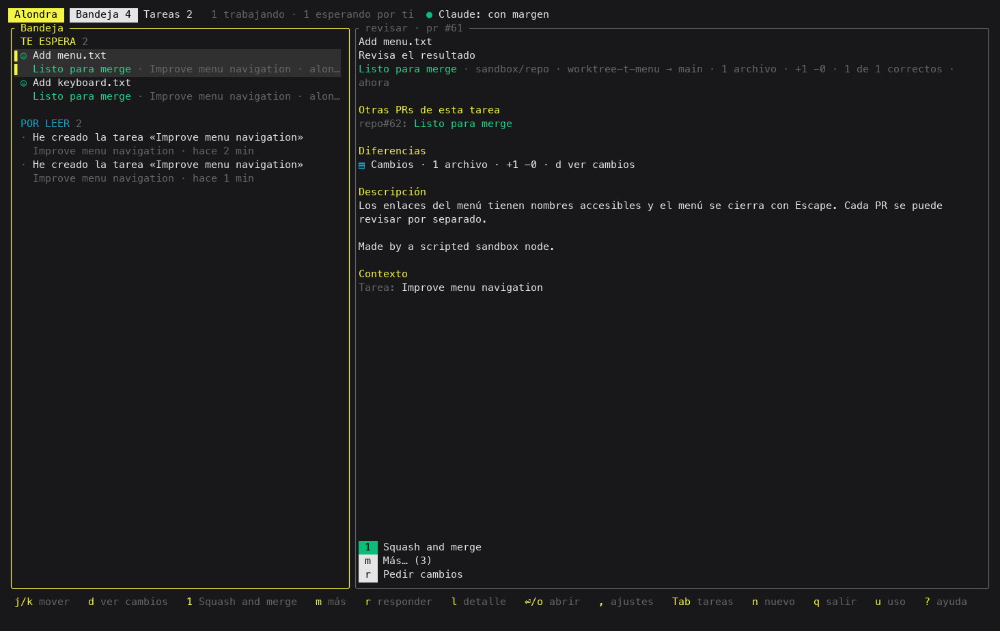
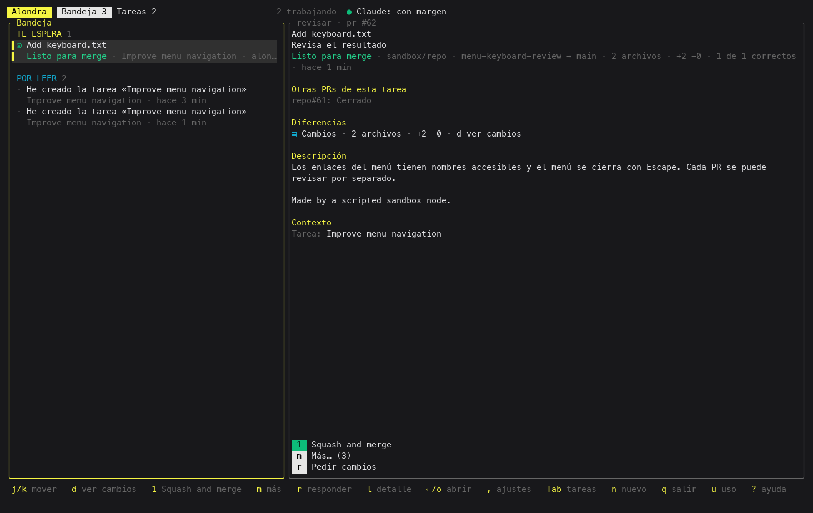

# Card types and their contracts

Every card Alondra puts in front of the user, the orchestrator or a node has a type, and every
type has a contract. The domain checks a new card against its contract before the card exists
(`crates/domain-model/src/card_contract.rs`): a node's or the orchestrator's card through the MCP,
a hook's held card, and each of Alondra's own cards. A card that breaks it is refused with code
`card_contract` (or the code of the field check that caught it) and a typed `contract` field in
the error: the card type, the rule it broke and the field.

## What a contract says

- **Created by**: who may send it. `node` is a node through the MCP, `hook` a Claude Code hook of a
  node held for the user, `orchestrator` the orchestrator through its tools, `alondra` the daemon.
  The orchestrator never asks the user about a task (a question, an action, an input or a trial
  scoped to it): that task's node asks, so the user never gets two cards about one thing.
- **Read by**: who it goes to. A suggestion and a node stuck on refused cards go to the
  orchestrator, never to the user.
- **Kind**: the `CardKind` it may carry.
- **Reader can**: `decision` means it offers at least one action that changes something (an option,
  accepting the result); opening a link never counts. `read` means it is only read: it never
  blocks, is listed apart from what waits for the user and never counts on the app's icon.
  `either` is decided by its payload. Alondra's own problems that ask for something done outside
  Alondra (close a PR on GitHub, fix the `gh` login) and withdraw themselves once they see it done
  carry a cause and no option.
- **Carries**: the fields it must have.
- **About**: what it refers to.
- **Need**: who writes what the reader does. A result's need is Alondra's, from its type, so a
  result can never ask in it for a decision its buttons do not take: a decision is an `ask`.
- **Goes away when**: what retires it without an answer.

The type of a card comes from the command and its fields (its system kind, whether a hook holds
it, its payload and its kind), never from its words.

## Deliveries and pull requests

### How a task gets its pull requests

A pull request becomes a task's only through a real action, never through text:

- the task's node registers it with `register_pr`;
- at a final delivery, the daemon asks GitHub which PR is open for the branch checked out in each
  of the task's worktrees (`gh pr view` in that folder), and adds the one GitHub reports.

Nothing else adds a PR to a task: not a command's line or output (`gh pr create` included), a
transcript, a message, a hook's text or an address matched by pattern. A test run that prints a
fixture's PR address, or a `grep` for `gh pr create`, changes nothing. A PR the node opens in
another repository, or on a branch outside the task's worktrees, is the task's once the node
registers it.

The PRs noted for a task wait on a GitHub read before a delivery is admitted (`pr_being_read`).
Databases written while Alondra still took PR addresses from `gh pr create`'s output could hold a
PR GitHub never reads, such as a fixture's, which held every delivery of its task. The first
open of the database by a release with this rule drops, once, every noted PR that is not a
registered PR of its task; the open PR of a task's branch is noted again at its next final delivery.

### Reading them before a delivery

Before admitting a final delivery, the daemon rereads every unmerged PR registered by its task,
including a task with only one PR and PRs last seen closed, which GitHub may have reopened.
If GitHub cannot answer, the delivery waits for a successful read. A successful `gh pr close`
from either provider also schedules a fresh read; the command's
output never determines whether GitHub closed the PR.

A closed PR cannot be a delivery target (`pr_not_open`). In a final result, a PR URL or
`owner/repo#N` naming a PR registered to that same task must also be a typed target
(`cited_pr_not_target`), whether the PR is open or closed. Unregistered PRs and PRs registered
to another task can be cited as context. Plan cards and progress cards are exempt from the
citation check. These refusals name the card contract rule and field. References identify a PR
by its host, repository and number, so a task can deliver PRs in several repositories without
confusing equal numbers or equal commit hashes.

Every open PR in a delivery has its own card and its own validated merge action. Closing or
merging a PR retires its card, including when an old saved delivery still points to it. An old
link to the whole delivery opens its first remaining open PR, or reports that the card is settled
when none remains. Closed PRs never count as waiting to merge. Work declared after the merge
continues to belong to the task until the node finishes that work.

A new report about an already merged PR remains readable and can be acknowledged; it offers
no merge action and acknowledging it does not finish declared work after the merge.

### A PR review before publication and installation

A task with an approved plan can deliver an open PR while publication, installation or other
declared work must wait for its merge. The node uses the existing MCP tools and arguments:

1. Call `post_merge_work` with `task_id` and a `reason` describing the work after merge.
2. Call `present_result` with `is_final: true`, a `pull_request` target and only the completed
   points in `checklist`, each with real evidence. For a six-point release with the first three
   points finished, send points 1–3. Points 4–6 stay in the approved plan without completion marks;
   the review shows them as pending after merge.
3. After merge, finish that work in the same task. Present a new final result with all six points
   and their evidence, including the evidence already supplied for points 1–3. Then end
   `post_merge_work` without `reason` and complete cleanup when Alondra asks.

No new MCP parameter, invented evidence or replacement plan is needed. Partial evidence is
admitted only with a registered open PR and a prior declaration of work after merge. A merged
PR or a text result cannot keep deferring the checklist. Ending the declaration, confirming
cleanup or completing the task while points remain unproved is refused. A session that ends
is recorded and can be replaced; it never proves the remaining work or completes the task.
Cancellation keeps its existing cleanup path.

The release review shows completed evidence and pending work separately in the real TUI:

| Dark appearance | Light appearance |
|---|---|
|  |  |

The TUI renders a separate review for each open PR. In this synthetic sandbox, closing PR #61
removes its card while PR #62 keeps its merge and feedback actions:

| Two open PRs | After closing PR #61 |
|---|---|
|  |  |

## Permissions Alondra answers itself

A command a node asks to run becomes a `permission` card unless Alondra decides it, recording the
decision in the task:

- The git commands of the conflict flow, in the task's worktree and on its branch, are allowed;
  `git reset --hard` and a force-push to another branch are denied
  ([task_git](../crates/core/src/task_git.rs)).
- A command that makes one change to files of the task's own worktrees is allowed: `rm` (also of
  a subfolder), `rmdir`, `unlink`, `mv`, `sed -i` with substitutions or deletions, `truncate`,
  `chmod` and `git checkout`/`git restore` of paths, beside nothing but `true`. The daemon reads
  the disk when the request arrives: each path's folder is canonicalized and its last name is not
  followed, so a link that points outside is removed and never entered. The path must stay
  strictly inside a linked worktree the task holds alone, in a repository's `.claude/worktrees` or
  Alondra's worktree storage, never on its root, a `.git` (in any case) or another worktree. git
  must run in that worktree's own repository, with its git folder outside it and no
  `post-checkout` hook. Everything else keeps the card
  ([own_worktree](../crates/core/src/own_worktree.rs)): a path that leaves the worktree or cannot
  be read for certain, a `cd` or a second change in the same command, a pattern, a variable, a
  word zsh expands (`=node`, an unquoted `^` or `~`), a wrapper, any other program, a `sed` whose
  BSD and GNU readings differ (`-i` with a suffix word, an option after the first file, a bracket
  expression), or one of the user's «ask» rules.
- What the user allowed «in this task» is allowed again.

Everything else is the user's, and the card marks with «⚠️ destructivo» what deletes, overwrites
or forces, read from the command's words.

## Catalog

| Type | Created by | Read by | Kind | Reader can | Carries | About | Need | Goes away when |
|---|---|---|---|---|---|---|---|---|
| `question` | node, orchestrator, alondra | user, orchestrator, node | decide | decides | title | task | its author | answered, withdrawn, replaced, task_ended |
| `action` | node, orchestrator, alondra | user, orchestrator, node | do | decides, or write | title, why, verify | task | its author | answered, withdrawn, replaced, task_ended |
| `input` | node, orchestrator, alondra | user, orchestrator, node | provide | decides, or write | title, why | task | its author | answered, withdrawn, replaced, task_ended |
| `trial` | node, orchestrator, alondra | user, orchestrator, node | test | decides | title | task | its author | answered, withdrawn, replaced, task_ended |
| `suggestion` | node | orchestrator | propose | decides | title, why | task | its author | answered, withdrawn, replaced, task_ended |
| `notice` | node, orchestrator, alondra | user, orchestrator, node | know | reads | title | request | its author | read, withdrawn, replaced |
| `problem` | orchestrator, alondra | user | problem | decides | title, why | task | its author | answered, withdrawn, replaced, resolved, task_ended |
| `result` | node | user | review, know | decides | title, content | pull_requests | Alondra: «Review the result» | accepted, handed_back, replaced, task_ended, pr_merged, pr_closed |
| `proposed_plan` | node | user | review | decides | title, content | task | Alondra: «Review the plan» | accepted, handed_back, replaced, task_ended |
| `progress` | node | user | know, review | reads | title | task | Alondra: «Read this update» | read, replaced, task_ended |
| `permission` | hook | user | authorize | decides | — | task | its author | answered, withdrawn, replaced, task_ended |
| `held_plan` | hook | user | review | decides | — | task | its author | answered, withdrawn, replaced, task_ended |
| `held_question` | hook | user | decide, provide | decides | — | task | its author | answered, withdrawn, replaced, task_ended |
| `elicitation` | hook | user | provide | decides, or write | — | mcp_server | its author | answered, withdrawn, replaced, task_ended |
| `system:node_pause` | alondra | user | decide | decides | — | task | its author | answered, resumed, task_ended |
| `system:over_pace` | alondra | user | decide | decides | — | task | its author | answered, withdrawn, resumed |
| `system:pace_resume` | alondra | user | decide | decides | — | task | its author | answered, withdrawn, resumed |
| `system:machine` | alondra | user | problem | decides | — | task | its author | answered, withdrawn, replaced, resolved, task_ended |
| `system:local_network` | alondra | user | problem | decides | — | task | its author | answered, withdrawn, replaced, resolved, task_ended |
| `system:report_held` | alondra | user | problem | decides | — | task | its author | answered, withdrawn, replaced, resolved, task_ended |
| `system:capability_capacity` | alondra | user | problem | decides | — | task | its author | answered, withdrawn, replaced, resolved, task_ended |
| `system:mcp_wait` | alondra | user | problem | decides | — | mcp_server | its author | answered, resolved, task_ended |
| `system:claude_signed_out` | alondra | user | problem | decides | — | task | its author | answered, resolved, task_ended |
| `system:claude_outage` | alondra | user | problem | decides | — | task | its author | answered, resolved, task_ended |
| `system:claude_usage` | alondra | user | problem | decides | — | task | its author | answered, resolved, task_ended |
| `system:host_lost` | alondra | user | problem | decides | — | task | its author | answered, withdrawn, replaced, task_ended |
| `system:turn_ended` | alondra | user | decide, problem | decides | — | task | its author | answered, withdrawn, replaced, task_ended |
| `system:stalled` | alondra | orchestrator | decide | decides | — | task | its author | answered, withdrawn, replaced, task_ended |
| `system:session_ended` | alondra | user | decide, problem | decides | — | task | its author | answered, withdrawn, replaced, task_ended |
| `system:handoff_doubt` | alondra | user | decide, problem | decides | — | task | its author | answered, withdrawn, replaced, task_ended |
| `system:decision_cancelled` | alondra | user | decide, problem | decides | — | task | its author | answered, withdrawn, replaced, task_ended |
| `system:dropped` | alondra | user | decide, problem | decides | — | task | its author | answered, withdrawn, replaced, task_ended |
| `system:unheard` | node, alondra | user | decide | decides | — | task | its author | answered, withdrawn, replaced, task_ended |
| `system:ended_unanswered` | alondra | user | know | reads | — | question | its author | read, withdrawn |
| `system:start_problem` | alondra | user, orchestrator | problem | decides | — | task | its author | answered, withdrawn, replaced, resolved, task_ended |
| `system:post_merge_problem` | alondra | user | problem | decides | — | task | its author | answered, withdrawn, replaced, resolved, task_ended |
| `system:close_problem` | alondra | user | problem | decides | — | task | its author | answered, withdrawn, replaced, resolved, task_ended |
| `system:discard_worktrees` | alondra | user | problem | decides | — | task | its author | answered, withdrawn, replaced, resolved, task_ended |
| `system:open_pr_delivery` | alondra | user | review, know | decides | — | pull_requests | its author | accepted, handed_back, replaced, task_ended, pr_merged, pr_closed |
| `system:launch_problem` | alondra | user | problem | decides | — | task | its author | answered, withdrawn, replaced, resolved, task_ended |
| `system:batch_problem` | alondra | user | problem | decides | — | task | its author | answered, withdrawn, replaced, resolved, task_ended |
| `system:stuck_problem` | alondra | user | problem | decides | — | task | its author | answered, withdrawn, replaced, resolved, task_ended |
| `system:request_done` | alondra | user | know | reads | — | request | its author | read, withdrawn, replaced |
| `system:request_tasks` | alondra | user | know | reads | — | request | its author | read, withdrawn, replaced |
| `system:inbox` | alondra | orchestrator, user | know, problem | either | — | request | its author | answered, read, withdrawn, replaced |
| `system:refused_cards` | alondra | orchestrator | know | reads | — | task | its author | read, withdrawn |
| `system:spec_change` | alondra | user | decide | decides | — | task | its author | answered, withdrawn, task_ended |
| `system:unknown` | — | — | — | reads | — | task | its author | — |
