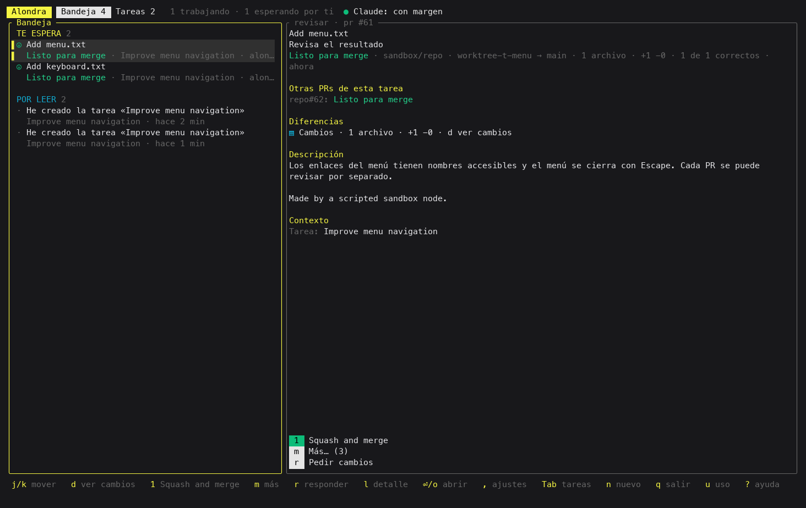
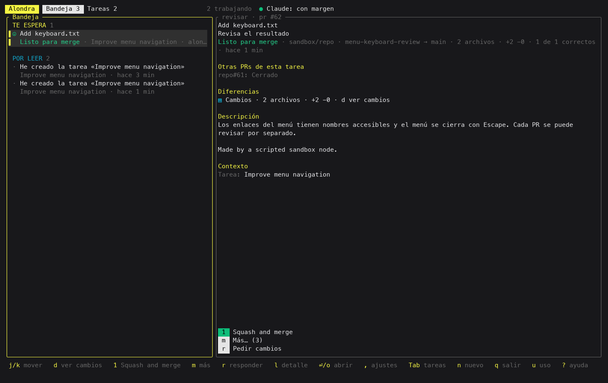

# Card types and their contracts

Every card Alondra puts in front of the user, the orchestrator or a node has a type, and every
type has a contract. The domain checks a new card against its contract before the card exists
(`crates/core/src/domain/card_contract.rs`): a node's or the orchestrator's card through the MCP,
a hook's held card, and each of Alondra's own cards. A card that breaks it is refused with code
`card_contract` (or the code of the field check that caught it) and a typed `contract` field in
the error: the card type, the rule it broke and the field.

## What a contract says

- **Created by**: who may send it. `node` is a node through the MCP, `hook` a Claude Code hook of a
  node held for the user, `orchestrator` the orchestrator through its tools, `alondra` the daemon.
- **Read by**: who it goes to. A suggestion and a node stuck on refused cards go to the
  orchestrator, never to the user.
- **Kind**: the `CardKind` it may carry.
- **Reader can**: `decision` means it offers at least one action that changes something (an option,
  accepting the result); opening a link never counts. `read` means it is only read: it never
  blocks, is listed apart from what waits for the user and never counts on the app's icon.
  `either` is decided by its payload. Alondra's own problems that ask for something done outside
  Alondra (close a PR on GitHub, fix the `gh` login) and withdraw themselves once they see it done
  carry a cause and no option.
- **Carries**: the fields it must have.
- **About**: what it refers to.
- **Need**: who writes what the reader does. A result's need is Alondra's, from its type, so a
  result can never ask in it for a decision its buttons do not take: a decision is an `ask`.
- **Goes away when**: what retires it without an answer.

The type of a card comes from the command and its fields (its system kind, whether a hook holds
it, its payload and its kind), never from its words.

## Deliveries and pull requests

Before admitting a final delivery, the daemon rereads every unmerged PR registered by its task,
including a task with only one PR and PRs last seen closed, which GitHub may have reopened.
If GitHub cannot answer, the delivery waits for a successful read. A successful `gh pr close`
from either provider also schedules a fresh read; the command's
output never determines whether GitHub closed the PR.

A closed PR cannot be a delivery target (`pr_not_open`). A PR URL or `owner/repo#N` cited in the
delivery's text must also be a typed target (`cited_pr_not_target`). These refusals name the card
contract rule and field. References identify a PR by its host, repository and number, so a task
can deliver PRs in several repositories without confusing equal numbers or equal commit hashes.

Every open PR in a delivery has its own card and its own validated merge action. Closing or
merging a PR retires its card, including when an old saved delivery still points to it. An old
link to the whole delivery opens its first remaining open PR, or reports that the card is settled
when none remains. Closed PRs never count as waiting to merge. Work declared after the merge
continues to belong to the task until the node finishes that work.

A new report about an already merged PR remains readable and can be acknowledged; it offers
no merge action and acknowledging it does not finish declared work after the merge.

The TUI renders a separate review for each open PR. In this synthetic sandbox, closing PR #61
removes its card while PR #62 keeps its merge and feedback actions:

| Two open PRs | After closing PR #61 |
|---|---|
|  |  |

## Catalog

| Type | Created by | Read by | Kind | Reader can | Carries | About | Need | Goes away when |
|---|---|---|---|---|---|---|---|---|
| `question` | node, orchestrator, alondra | user, orchestrator, node | decide | decides | title | task | its author | answered, withdrawn, replaced, task_ended |
| `action` | node, orchestrator, alondra | user, orchestrator, node | do | decides, or write | title, why, verify | task | its author | answered, withdrawn, replaced, task_ended |
| `input` | node, orchestrator, alondra | user, orchestrator, node | provide | decides, or write | title, why | task | its author | answered, withdrawn, replaced, task_ended |
| `trial` | node, orchestrator, alondra | user, orchestrator, node | test | decides | title | task | its author | answered, withdrawn, replaced, task_ended |
| `suggestion` | node | orchestrator | propose | decides | title, why | task | its author | answered, withdrawn, replaced, task_ended |
| `notice` | node, orchestrator, alondra | user, orchestrator, node | know | reads | title | request | its author | read, withdrawn, replaced |
| `problem` | orchestrator, alondra | user | problem | decides | title, why | task | its author | answered, withdrawn, replaced, resolved, task_ended |
| `result` | node | user | review, know | decides | title, content | pull_requests | Alondra: «Review the result» | accepted, handed_back, replaced, task_ended, pr_merged, pr_closed |
| `proposed_plan` | node | user | review | decides | title, content | task | Alondra: «Review the plan» | accepted, handed_back, replaced, task_ended |
| `progress` | node | user | know, review | reads | title | task | Alondra: «Read this update» | read, replaced, task_ended |
| `permission` | hook | user | authorize | decides | — | task | its author | answered, withdrawn, replaced, task_ended |
| `held_plan` | hook | user | review | decides | — | task | its author | answered, withdrawn, replaced, task_ended |
| `held_question` | hook | user | decide, provide | decides | — | task | its author | answered, withdrawn, replaced, task_ended |
| `elicitation` | hook | user | provide | decides, or write | — | mcp_server | its author | answered, withdrawn, replaced, task_ended |
| `system:node_pause` | alondra | user | decide | decides | — | task | its author | answered, resumed, task_ended |
| `system:over_pace` | alondra | user | decide | decides | — | task | its author | answered, withdrawn, resumed |
| `system:pace_resume` | alondra | user | decide | decides | — | task | its author | answered, withdrawn, resumed |
| `system:machine` | alondra | user | problem | decides | — | task | its author | answered, withdrawn, replaced, resolved, task_ended |
| `system:local_network` | alondra | user | problem | decides | — | task | its author | answered, withdrawn, replaced, resolved, task_ended |
| `system:mcp_wait` | alondra | user | problem | decides | — | mcp_server | its author | answered, resolved, task_ended |
| `system:claude_signed_out` | alondra | user | problem | decides | — | task | its author | answered, resolved, task_ended |
| `system:claude_outage` | alondra | user | problem | decides | — | task | its author | answered, resolved, task_ended |
| `system:claude_usage` | alondra | user | problem | decides | — | task | its author | answered, resolved, task_ended |
| `system:host_lost` | alondra | user | problem | decides | — | task | its author | answered, withdrawn, replaced, task_ended |
| `system:turn_ended` | alondra | user | decide, problem | decides | — | task | its author | answered, withdrawn, replaced, task_ended |
| `system:stalled` | alondra | orchestrator | decide | decides | — | task | its author | answered, withdrawn, replaced, task_ended |
| `system:session_ended` | alondra | user | decide, problem | decides | — | task | its author | answered, withdrawn, replaced, task_ended |
| `system:handoff_doubt` | alondra | user | decide, problem | decides | — | task | its author | answered, withdrawn, replaced, task_ended |
| `system:decision_cancelled` | alondra | user | decide, problem | decides | — | task | its author | answered, withdrawn, replaced, task_ended |
| `system:dropped` | alondra | user | decide, problem | decides | — | task | its author | answered, withdrawn, replaced, task_ended |
| `system:unheard` | node, alondra | user | decide | decides | — | task | its author | answered, withdrawn, replaced, task_ended |
| `system:ended_unanswered` | alondra | user | know | reads | — | question | its author | read, withdrawn |
| `system:start_problem` | alondra | user, orchestrator | problem | decides | — | task | its author | answered, withdrawn, replaced, resolved, task_ended |
| `system:post_merge_problem` | alondra | user | problem | decides | — | task | its author | answered, withdrawn, replaced, resolved, task_ended |
| `system:close_problem` | alondra | user | problem | decides | — | task | its author | answered, withdrawn, replaced, resolved, task_ended |
| `system:discard_worktrees` | alondra | user | problem | decides | — | task | its author | answered, withdrawn, replaced, resolved, task_ended |
| `system:open_pr_delivery` | alondra | user | review, know | decides | — | pull_requests | its author | accepted, handed_back, replaced, task_ended, pr_merged, pr_closed |
| `system:launch_problem` | alondra | user | problem | decides | — | task | its author | answered, withdrawn, replaced, resolved, task_ended |
| `system:batch_problem` | alondra | user | problem | decides | — | task | its author | answered, withdrawn, replaced, resolved, task_ended |
| `system:stuck_problem` | alondra | user | problem | decides | — | task | its author | answered, withdrawn, replaced, resolved, task_ended |
| `system:request_done` | alondra | user | know | reads | — | request | its author | read, withdrawn, replaced |
| `system:request_tasks` | alondra | user | know | reads | — | request | its author | read, withdrawn, replaced |
| `system:inbox` | alondra | orchestrator, user | know, problem | either | — | request | its author | answered, read, withdrawn, replaced |
| `system:refused_cards` | alondra | orchestrator | know | reads | — | task | its author | read, withdrawn |
| `system:unknown` | — | — | — | reads | — | task | its author | — |
