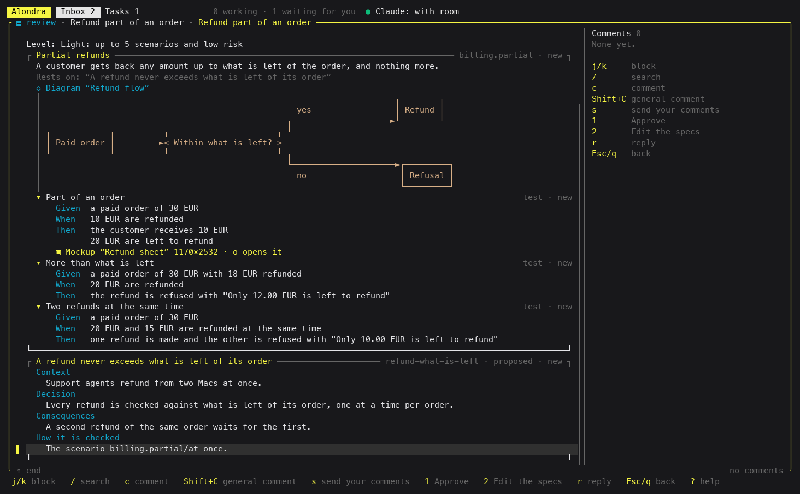
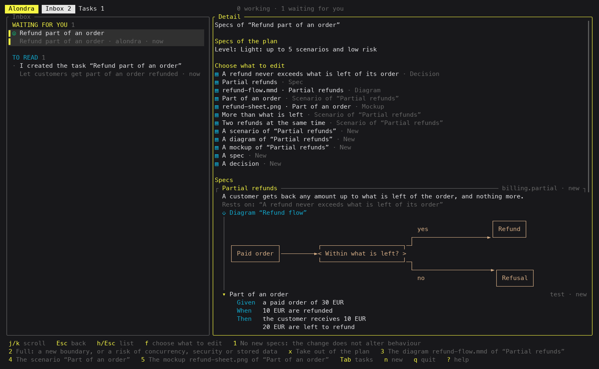
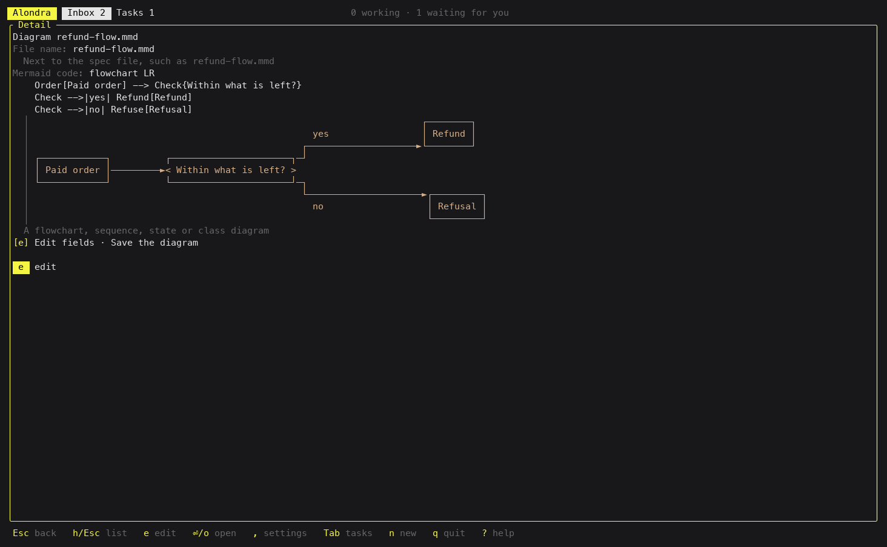
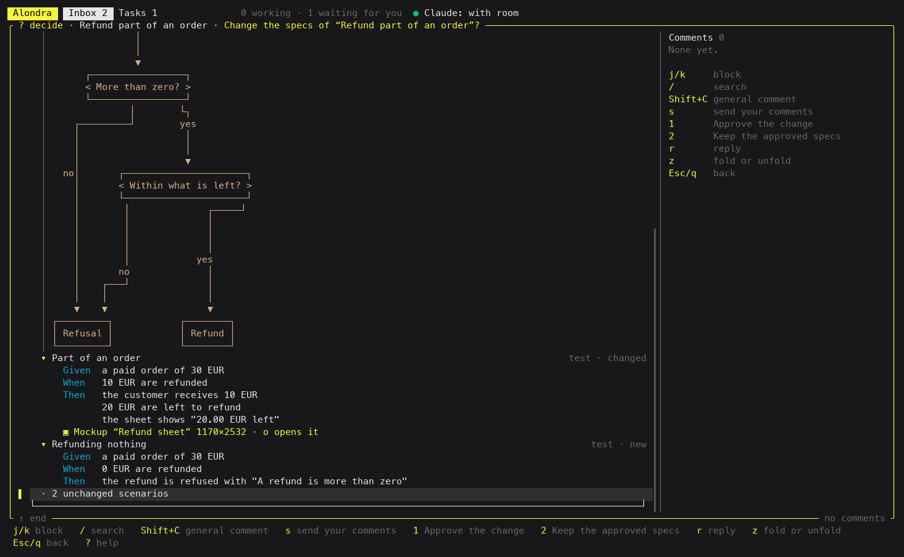
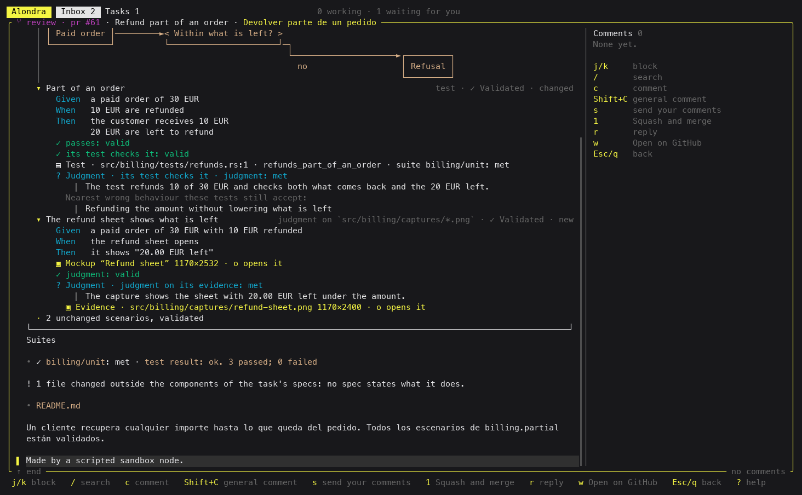

# Specs

How a project keeps its specs, what the spec engine checks and what it can and cannot guarantee.
The behaviour is specified in `specs/spec-engine/`; this page is the map and the exact formats.
Where it disagrees with a spec, the spec wins. To turn specs on in a project of your own, follow
[the guide](../enable-specs.md).

## What is guaranteed

The guarantee reaches as far as a scenario with a test reaches, whatever the test measures:
behaviour, a performance budget, a concurrency rule.

- Every scenario is declared by at least one test or is marked as a judgment.
- A scenario passes when every suite that holds one of its tests ran well on the current
  fingerprint of its component.
- A judgment (that a test really checks its scenario, that a capture or a video shows what the
  scenario says, that a reference section is still true) is a verdict someone recorded for the
  current fingerprint. It is evidence of a judgment, never of a fact.
- Nothing is guaranteed about what no test looks at. Code written again from the specs is equal to
  the old code only as far as the scenarios and their tests can tell.
- A ledger file can be written by hand. The engine does not know who recorded a verdict: its
  caller decides who may, and a continuous integration run executes the suites again.

## Three levels

| Level | What | Rules? |
|---|---|---|
| Visual explanation | Diagrams made when they help | No. Never stored as truth |
| Reference prose | `docs/reference/*.md`, each section anchored to what it explains | No. A spec wins over it |
| Specs | Feature files, boundaries, decisions | Yes. The only input of a regeneration |

## Files

```
alondra.toml                       settings
specs/<component>/boundary.toml    the boundary of a component
specs/<component>/*.feature        its specs
specs/<component>/**               the diagrams and mockups its specs cite
specs/ledger/...                   what was validated
docs/decisions/<id>.md             lasting decisions
docs/reference/*.md                reference prose
```

### `alondra.toml`

```toml
format = 1

[specs]
enabled = true      # default false
committed = true    # default true
dir = "specs"       # default "specs"

[decisions]
enabled = true      # default false
dir = "docs/decisions"

[reference]
enabled = true      # default false
dir = "docs/reference"
```

No other key is accepted. Folders are relative paths inside the repository. With specs disabled
nothing is read. With `committed = false` the specs live outside the repository and a marker with
no spec is not a problem.

### Limits and unreadable files

Every file the engine parses has a size limit; a larger one is refused with `too_large` naming the
file, before it is parsed.

| File | Limit in bytes |
|---|---|
| `alondra.toml`, `boundary.toml`, a ledger file | 65536 |
| A feature file, a decision, a reference document | 262144 |
| A diagram | 65536 |
| A mockup | 2097152 |
| JUnit results handed to `read_results` | 16777216 |

A listed file the engine needs (the settings, a boundary, a feature file, a decision, a reference
document, a ledger file, a test file of a suite or a cited diagram or mockup) that the caller cannot read is refused with
`unreadable_file` naming it. An owned file, an input or a piece of evidence that cannot be read
counts as absent in its fingerprint.

### Feature files

One spec per file. Tags are words that start with `@`, on the lines above `Feature:` or above a
scenario, one or several per line.

| Where | Tag | Meaning |
|---|---|---|
| Feature | `@spec:<id>` | The identifier of the spec. Exactly one |
| Feature | `@decision:<id>` | A decision the spec rests on |
| Feature or scenario | `@diagram:<file>` | A diagram that illustrates it |
| Feature or scenario | `@mockup:<file>` | A mockup that illustrates it |
| Scenario | `@id:<id>` | The identifier of the scenario. Exactly one |
| Scenario | `@judged`, `@judged:capture`, `@judged:video` | A judgment, and the evidence it needs |
| Scenario | `@evidence:<pattern>` | Committed captures the judgment looks at. Only with `@judged:capture` |
| Scenario | `@boundary:surface`, `@boundary:data`, `@boundary:dependencies` | The scenario states a promise of the boundary |
| Scenario | `@reserved` | Kept out of the packet handed to an implementer |

Identifiers use lowercase letters, digits, dots and hyphens and start with a letter or a digit.
A scenario is named `<spec>/<scenario>`.

Lines: `Feature: <title>`, free description lines, `Background:`, `Scenario: <title>` or
`Scenario Outline: <title>`, steps that start with `Given`, `When`, `Then`, `And` or `But`,
table rows between `|`, doc strings between two lines of `"""`, `Examples:` followed by a table,
comments that start with `#`, and blank lines. Anything else is a problem. The Gherkin keywords
`Rule:`, `Example:`, `Scenarios:` and `Scenario` followed by any words other than `Outline` (such
as `Scenario Template:`) are refused wherever they appear; any other line of the description, such
as `Note: refunds are rare`, is prose. A file is at most 262144 bytes and 200 scenarios; a
`Scenario:` line inside a doc string is text and does not count.

Escapes, so that every spec is written and read back unchanged:

- Table cells: a backslash is written `\\` and a pipe `\|`. Reading a row takes `\|` as a pipe,
  `\\` as a backslash, any other backslash as itself and every other pipe as the end of a cell.
- Doc strings: a line whose text, without its indentation, is made only of backslashes and quotes
  and turns into `"""` when the escape is undone zero or more times is written escaped once more:
  each backslash as `\\` and each quote as `\"`. So `"""` is written `\"\"\"`, and `\"\"\"` is
  written `\\\"\\\"\\\"`. Undoing the escape reads `\\` as `\` and `\"` as `"`, and applies only
  to a line in which every character is part of such a pair. Reading undoes it exactly once on
  such a line and keeps every other line as written.

Canonical form: feature tags one per line, `Feature:` at column 0, description indented 2, a blank
line between blocks, feature tags in the order spec, decision, diagram, mockup, scenario tags on
one line indented 2 in the order id, judged, evidence, boundary, reserved, diagram, mockup; steps indented 4; tables and doc strings indented 6 with cells padded to the
width of their column; `Examples:` indented 4 after a blank line, its table indented 6.

### Diagrams and mockups

A spec may keep pictures next to its feature file:

```gherkin
@spec:billing.partial
@diagram:refund-flow.mmd
Feature: Partial refunds

  @id:refund-sheet @mockup:refund-sheet.png
  Scenario: The refund sheet shows what is left
```

`<file>` is a path from the folder of the feature file, with `/` between segments. It may name a
subfolder; an absolute path, a backslash, or an empty, `.` or `..` segment is
`part_outside_component`. A tag has no spaces, so neither has a file name.

| Part | Extensions | What the file holds | Limit in bytes |
|---|---|---|---|
| Diagram | `.mmd` | UTF-8 Mermaid text. Its first word, after blank lines and lines that start with `%%`, is `flowchart`, `graph`, `sequenceDiagram`, `stateDiagram`, `stateDiagram-v2` or `classDiagram`: the kinds every Alondra client draws | 65536 |
| Mockup | `.png`, `.jpg`, `.jpeg` | A PNG or a JPEG, told by its bytes. The engine reads its width and height from its header | 2097152 |

The engine checks the first word of a diagram and the header of an image, not the rest: a diagram
with a mistake further down is shown by a client as its source.

| Problem | When | Names |
|---|---|---|
| `part_outside_component` | the path of a tag leaves the folder | the feature file and the tag's line |
| `invalid_part` | the extension is not the kind's, the same tag cites a file twice, a diagram is of no admitted kind or not UTF-8, a mockup is no PNG or JPEG or its size cannot be read | the feature file and the tag's line |
| `too_many_parts` | a spec holds more than 16 `@diagram:` and `@mockup:` tags, feature and scenarios together | the feature file and the line of the seventeenth |
| `missing_part` | the cited file is not listed | the feature file and the tag's line |
| `too_large` | the cited file is over its limit | the feature file and the tag's line |
| `uncited_part` | a `.mmd`, `.png`, `.jpg` or `.jpeg` file under `specs/<component>/` is cited by no tag and matched by no `@evidence:` pattern. Not reported while a feature file of that folder cannot be read | that file |

`alondra spec list` gives each spec and each scenario its `parts`: `path` from the root, `kind`
(`diagram` or `mockup`), `fingerprint`, `bytes`, and `width` and `height` (`null` for a diagram).

### Markers

In the files a suite lists as `tests`, a comment `spec: <spec>/<scenario>` declares that the test
below verifies that scenario. The comment starts with `//`, `///` or `#` after optional spaces.
The test name is the function declared in the eight lines after the marker: `fn <name>`,
`func <name>`, `def <name>`, or the first quoted text of `test(` or `it(`.

### `boundary.toml`

```toml
id = "billing"                         # the name of its folder
owns = ["crates/billing/**"]           # required
regenerates = ["crates/billing/src/**"]
inputs = ["Cargo.toml"]
depends_on = ["ledger"]
data = ["specs/ledger/**"]
fixtures = ["crates/billing/fixtures/**"]
surface = "specs/billing/surface.txt"

[[suite]]
id = "unit"
run = ["bazelisk", "test", "//crates/billing:test"]   # at least one argument
tests = ["crates/billing/tests/**/*.rs"]
results = "bazel-testlogs/**/test.xml"
timeout_minutes = 30                                  # default 30
```

A boundary delimits; it promises nothing. A boundary needs a scenario tagged
`@boundary:dependencies`; one tagged `@boundary:surface` when it names a surface; one tagged
`@boundary:data` when `data` is not empty.

Patterns: `*` is any run of characters inside one segment, `**` any number of whole segments
(at least one when it ends the pattern). Consecutive `**` segments count as one, and matching never
tries the same place of the pattern against the same place of the path twice, so its time grows
with the product of their lengths.

No pattern of `owns` or `inputs` may reach the ledger, whether or not a ledger file exists yet:
its segments are walked against those of `<specs dir>/ledger`; a `**` reaches it, a segment that
matches goes on, one that does not cannot reach it, a pattern that ends first cannot reach it, and
a pattern with segments left after the ledger folder reaches it. `data` may name the ledger.
Problems about a key name the line of that key, or of the pattern they are about.

### Decisions

```markdown
+++
id = "keep-ledger"            # the name of the file
title = "Keep a ledger"
status = "accepted"           # proposed | accepted | rejected | superseded | deprecated
date = "2026-11-25"
supersedes = []
superseded_by = ""
+++

## Context
## Decision
## Consequences
## Confirmation
```

A decision that supersedes another needs the other one to be `superseded` and to name it in
`superseded_by`. A `superseded` decision needs a `superseded_by` that names a decision listing it
in `supersedes`. Either mismatch is `supersession_mismatch`.

### Reference prose

```markdown
## How refunds work
<!-- section: billing.refunds-overview explains: billing.refunds, boundary:billing, decision:keep-ledger -->
```

The comment is on the line right after the heading. Any line there that starts with `<!--` is
read as the section comment, and one that does not read as above is a problem at its line. Text
before the first `##` belongs to no section.

### The ledger

```
specs/ledger/<component>/suites/<suite>.toml               inputs = "sha256:…"
specs/ledger/<component>/scenarios/<spec>/<scenario>.toml  [adequate] and [judged]
specs/ledger/reference/<section>.toml                      [reference]
```

```toml
[adequate]
inputs = "sha256:…"
verdict = "met"

[judged]
inputs = "sha256:…"
verdict = "met"
evidence = ["sha256:…"]
```

Tables are written in the order adequate, judged, with a blank line between them; `evidence` only
when there is some. No other key is accepted. A `[judged]` table of a scenario tagged
`@judged:capture` or `@judged:video` with no `evidence` is refused with `evidence_required`.

## Fingerprints

`sha256:` and 64 lowercase hexadecimal digits. Each is the SHA-256 of a text built from lines, so
that nothing but the inputs below can change it:

| Fingerprint | Inputs |
|---|---|
| Component | The path and the content hash of every listed file that matches `owns` or `inputs`, in path order, then the fingerprint of every component in `depends_on`, in id order |
| Suite | The component, the suite id, its arguments, each of its `tests` patterns, and the path and content hash of every listed file that matches one of them, in path order |
| Adequate | The canonical text of the scenario, the title, description and background of its spec, the path and content hash of every diagram and mockup of the feature and of the scenario, and the path and content hash of every test file that declares it |
| Judged | The canonical text of the scenario, the path and content hash of every diagram and mockup of the scenario and, with `@evidence`, the path and content hash of every listed file that matches it; without it, the component |
| Reference | The text of the section and, for everything it explains, the canonical text of the spec or the content hash of the boundary or decision file |

## States

| State | Meaning |
|---|---|
| `valid` | Recorded with the current fingerprint and verdict `met` |
| `missing` | Never recorded |
| `stale` | Recorded with another fingerprint |
| `unmet` | Recorded with the current fingerprint and verdict `unmet` |
| `failed` | Test results were given and a test that declares the scenario did not pass: no case is that test, a case that is that test failed, had an error or was skipped, or the marker has no test name |
| `uncovered` | No test declares the scenario and it is not a judgment |

Items: `suite` for `<component>/<suite>`; `passes`, `adequate` and `judged` for a scenario;
`reference` for a section. A scenario that tests declare has `passes` and `adequate`; one that no
test declares and is not a judgment has only `passes`, as `uncovered`; a judgment has `judged`.
Items are ordered by subject, then by kind.

Report status: `unreadable` with problems, `clean` when every item is `valid`, `pending`
otherwise. Problems are ordered by path, line and code.

## The command

```
alondra spec validate [--json] [--junit <file>]      0 clean, 1 pending, 2 unreadable
alondra spec run <component> [--suite <id>]         0 recorded, 1 a suite failed, 2 not runnable
alondra spec record <subject> --kind adequate|judged|reference --verdict met|unmet [--evidence <file>]...
alondra spec list
alondra spec packet <component>
```

`validate` never runs a command, starts an agent or writes a file.

`run` executes each command of the plan without a shell, from the root of the repository, in a
process group of its own. At its time limit every process of that group is stopped, and so is it
when `alondra spec run` itself is interrupted. Its output is shown up to 8 MiB and dropped after
that. Only a suite that ends well within its limit gets its ledger entry.

`run` and `record` write a ledger entry to a new file that then takes the place of the old one,
and never through a link: when a folder on the way or the entry itself is a link, nothing is
written and the command ends with 2 and `path_outside_repository`. A listed file that leaves the
checkout through a link is not read.

The command asks git for the files it tracks and the new ones it does not ignore, which is what a
commit of the whole working tree would hold, and reads them from the working tree. A file git
ignores never changes a result.

## The packet

```
# Component <id>

Specs are the only source of truth. Where any other text disagrees with a spec, the spec wins.

## What you may write
## What you must not change
## Boundary
## Decisions
## Specs
## Reference (context, not a requirement)
```

Scenarios tagged `@reserved` are left out of the specs in a packet. After each spec come the
parts it cites, each once: the text of a diagram in a `mermaid` block and the path and size of a
mockup. A part cited only by a reserved scenario is left out.

## Regeneration pilot

`make regeneration-pilot COMPONENT=spec-engine RUNS=5 MODEL=sonnet` gives a model, in a temporary
folder outside the checkout, the component without the files it regenerates and without the tests
of its reserved scenarios, together with its packet, and measures each result with the component's
real suites: suites that pass, tests that pass, reserved tests that pass, and, through the suite
that compares it, whether the public surface is the committed one. `BASELINE=1` hands the model a
short description and the surface instead of the packet and the tests. It costs tokens and builds,
and it replaces files of the checkout while it measures, so it is run by hand on a clean checkout
(`tools/regeneration_pilot.py`).

## Specs in a task

In a project whose `alondra.toml` turns specs on, the specs of a change go with its plan, the user
approves them with it, and nothing changes them afterwards without the user's approval. Alondra
keeps them in the task (`TaskSpecs`, M-LIFE-16 of `docs/architecture/state-machines.md`) and reads
every set with this engine over the task's worktree: never what an agent says about them.

### Proposed with the plan

A task that changes behaviour in such a project goes in stages. Its author designs the specs with
the user (the `spec-design` skill) and sends them with `propose_specs` before presenting the plan:
each file whole (a feature file, a boundary, a decision with status `proposed`, a reference
section, the settings), and a level:

| Level | When |
|---|---|
| `none` | The change alters no behaviour; no file |
| `light` | Up to 5 scenarios and low risk |
| `full` | More than 5 scenarios, a new boundary, or a risk of concurrency, security or stored data |

Alondra reads the worktree with the proposal over it and refuses the call with every problem by
file and line, so a proposal on a plan always reads clean. A proposal only changes `alondra.toml`
and files under the specs folder (never its ledger), the decisions folder and the reference folder.
A decision the proposal adds reads as accepted, as approving the plan makes it, so a spec may cite
it.

A diagram is a file of the proposal like any other, sent as its text. A mockup is sent with
`source`, a PNG or JPEG of the author's worktree: Alondra reads it (never through a link, at most
the engine's 2 MiB), keeps a copy by its digest in its images folder and records in the task its
fingerprint, size and dimensions. What an agent says about a mockup is never taken as it is.

### Sheets

Every client draws a spec as a sheet and a decision as a sheet (the view items `spec_sheet` and
`decision_sheet`), never as raw Gherkin. A spec's sheet holds its title, identifier and change
mark (new, changed, removed or unchanged, compared with what the project has), its explanation,
the decisions it rests on, its diagrams and mockups, and each scenario with its kind (test, or a
judgment and its evidence), its steps in the lanes Given, When and Then (`And` and `But` join the
lane before them), tables, examples and its own parts. The scenarios a change leaves as they are
fold into one line; with more than 8 changed, each starts closed. A boundary is shown as data: what
it owns, what is regenerated and its suites. A comment can be anchored to a spec, a scenario, a
diagram, a mockup or a decision. Every state is told by an icon and words, never by color alone.
A client that does not know these items draws the row asking to update; one that does not know
the field kinds for steps and Mermaid gets them as multiline text.

### On the plan's card

The plan's card has a section «Specs»: the sheets of the specs and decisions it changes, then the
other files. «Edit the specs» opens screens where the user changes the level and adds, edits or
removes a spec, a scenario (title, steps, judged or not), a diagram (its Mermaid text), a mockup
(an attached PNG or JPEG) or a decision. Every edit is made on the proposal and read by the engine
at once; a problem comes back next to its field and the proposal stays as it was. Removing the
last citation of a diagram or mockup removes its file with it: from the proposal when the proposal
added it, and from the project with the change when the project had it, unless another spec cites
it. Taking a decision out of the proposal records it as rejected. A change to approved specs draws
the same sheets, marked against what each file held.

Approving the plan approves that exact set, with its decisions accepted and the user's words kept
in Alondra. The plan cannot be approved while the proposal or the worktree's settings cannot be
read: the button says why.

In the terminal, «2» on the plan's card opens the editor, «f» picks what to edit and «e» edits its
fields. A mockup is attached by pasting or dropping the path of its image. In the reader, a comment
quotes the identifier of the part it is on, «z» folds and unfolds a scenario, Mermaid diagrams are
drawn, and a mockup or capture is a framed line that «o» opens in the Mac's image viewer:

| The plan's card in the reader | The editor |
|---|---|
|  |  |

| A diagram's form, drawn under its code | A change to the approved specs |
|---|---|
|  |  |

On the iPhone and the Mac the same sheets are native views, built once in the design library
and shared by both. A scenario is a card that folds, its lanes sit under their names and, on a
window wide enough, beside its mockup; a mockup is a thumbnail of its real proportion that opens
full screen and zooms, a diagram is drawn with its summary read by VoiceOver, and a capture of the
evidence is drawn under the verdict it belongs to, which is always marked as a judgment. A scenario
says its kind and what changed, and in a delivery its state; every part has its alternative text.
Tapping a scenario, a spec, a decision or a diagram in the editor opens its form over the list. The
steps are edited as rows (lane, words, table, with add, remove and reorder buttons), a diagram's
Mermaid text is drawn as it is typed and a mockup is attached from a photo or a file. The edit
shows at once on its sheet marked «saving» and goes on retrying without a notice; after 30 seconds
without the Mac's confirmation the sheet says so, and an edit the Mac refuses goes back to what it
was and its form opens again with the reason beside the field. The apps ask for the capability
`spec_fields`; without it the daemon sends steps and Mermaid as multiline text.

### Written while no agent works

Alondra writes the approved files, mockups byte for byte, into the task's worktree itself, and only while no agent of the
task works: between the author's last turn and the implementer's first, or when the implementer
rests. A change of role waits for them. The implementer commits them as they are; its context says
which they are and that specs win over any other text.

### Changes afterwards

The implementer never edits a spec, boundary or decision: it asks with `request_spec_change`. The
task goes back to an author, who drafts the change with `propose_amendment`; the user gets a card
with what each file held and what it would hold, and the implementer takes the task back meanwhile.
An approved change is written like the plan's; a rejected one leaves the approved specs, and the
implementer hears the user's words.

A lasting decision outside a plan goes on a card of its own (`propose_decision`): accepted, Alondra
writes it and marks every decision it supersedes as superseded by it.

### At delivery

A final delivery is refused with `specs_differ` when the branch holds a spec file changed from
where it leaves its base branch without the user's approval, or an approved one otherwise than
approved (every file is compared by its bytes, so a mockup counts like a spec); reference prose is reviewed with the delivery and the ledger is the validation's. It is
refused with `spec_settings_unreadable` when the settings cannot be read: a broken `alondra.toml`
never turns specs off.

| Project | What happens |
|---|---|
| No `alondra.toml`, or specs not enabled | Nothing: `propose_specs` is refused with `specs_disabled` |
| `alondra.toml` that cannot be read | No plan is approved and no result delivered until it is fixed; the task shows why |
| `committed = false` | The approved specs live in Alondra and are never written into the worktree nor committed; the card says nothing can be regenerated from them later |

## Validation of a task

In such a project the implementer of a task in stages never delivers work the engine still lists as
not validated. A new agent, the validator, checks it, and Alondra counts only what that validator
recorded, each at the fingerprint Alondra itself read of the commit it validates (M-LIFE-17 and
M-LIFE-18 of `docs/architecture/state-machines.md`).

### Ready for validation

The implementer commits its work and calls `ready_for_validation`. Alondra reads that commit with
the engine and opens a round with every item that is not `valid`, each with its fingerprint, and
the files the branch changed outside the task's components. It is refused with
`nothing_to_validate` when nothing is listed (the implementer then delivers as usual),
`uncommitted_work` while the worktree holds changes no commit has, `specs_uncovered` while a
scenario has no test and is no judgment, and `spec_change_pending` while a change of the specs waits.

### The validator

A new execution in the validator's role starts from what Alondra writes for it: the round's commit
and items, and the `spec-validation` skill. It runs each suite (`alondra spec run`), judges each
judgment (`alondra spec record`) and records each result with `record_validation`: subject, check
(`suite`, `adequate`, `judged`, `reference`), verdict (`met`, `unmet`, `incomplete`), the end of a
run's output, a judgment's reasoning and, for `adequate`, the nearest wrong behaviour the tests
would still accept. Only the validator records; Alondra fills the fingerprint itself.

It then delivers with only the ledger committed, or ends the round with `end_validation`:

| The round holds | What follows |
|---|---|
| an item `unmet` | the work goes back to the implementer with the findings; the third round in a row asks the user: go on with the author's model, change the specs, or cancel |
| only items it could not run | a new validator tries once more; then the user decides: validate again or cancel |

What comes after a validated delivery (the user asks for changes, the pull request has conflicts)
goes back to an implementer. A commit the pull request receives after the delivery withdraws it and
the validator validates again only what changed fingerprint. A validator whose host is lost keeps
what it recorded; what it owed is `incomplete` and is owed again when the task goes on.

### The gate

A final delivery of a task in stages is read on its commit before it reaches the user, within the
time the delivery review gives git:

| Refusal | When |
|---|---|
| `validation_required` | the implementer delivers while the engine lists something |
| `specs_differ` | a spec, boundary or decision differs from what the user approved |
| `validation_pending` | `alondra spec validate` is not clean on the delivered commit |
| `spec_change_open` | a change of the specs waits for its author or the user |
| `ledger_unrecorded` | a ledger entry the branch changed has no record of the validator with its fingerprint and verdict |
| `changed_after_validation` | anything but the ledger changed after the round's commit |
| `worktree_unreadable` | git cannot read the worktree, or not in time |

So the three ways to cheat are caught: a spec changed without approval (`specs_differ`), a ledger
written by hand (`ledger_unrecorded`), a test weakened after its judgment (its `adequate`
fingerprint changes, so the delivery is `validation_pending` until a validator judges it again).

### What the delivery shows

The card of a validated delivery has a section «Specs», read from the delivered commit when it
passed the gate: the sheet of each spec of the task's components, each scenario with its state
(validated, not validated, validating now or evidence not available), the engine's state of each
check, the tests that declare it (file and line) and the suites that hold them with their result,
and what the validator judged, always labelled a judgment. Alondra keeps a copy of each PNG and
JPEG capture the judgments rest on, as the delivered commit holds them (the paths the validator
named, or else those `@evidence` matches), so they can be opened from the card; a capture the
commit does not hold, a video, or a delivery recorded before Alondra kept them reads as evidence
not available. the suites; the files changed outside the task's
components; and the reference prose the branch changed. A point of the approved plan may cite a
scenario as `scenario` evidence (`billing.partial/part`); the card shows how it was validated.



