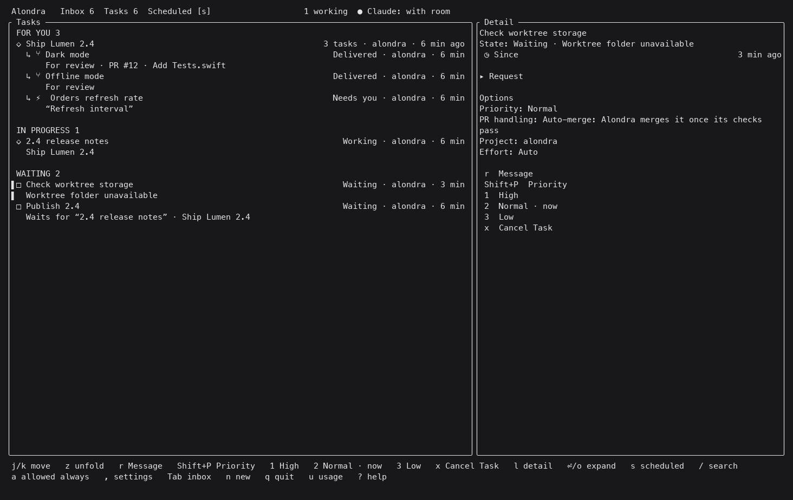
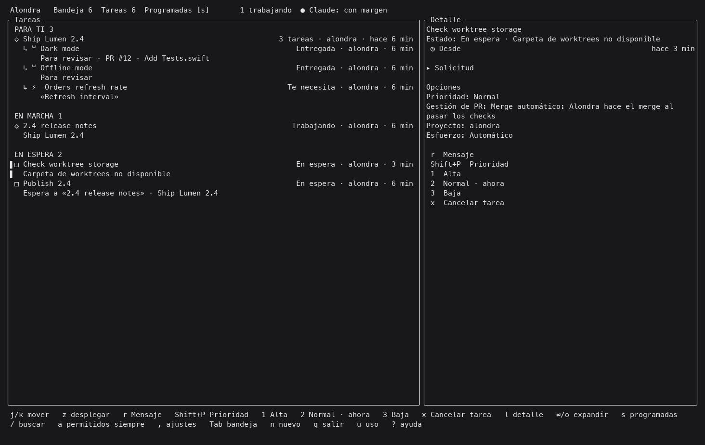

# Worktree storage

Without a `worktrees_root` setting, new task worktrees live in
`<repository>/.claude/worktrees/<task>`, as before. Existing worktrees keep their location. A
restarted or reopened task reuses its recorded worktree and branch; changing the setting does
not move work or change native session history.
Tasks launched from a repository subfolder keep that working directory inside their worktree;
ownership and cleanup refer to the whole worktree.

## Choosing a folder

Create an empty folder on the volume you want to use, then run:

```sh
alondra config set worktrees_root /Volumes/Worktrees/tasks
alondra config get worktrees_root
alondra config get worktrees_volume_id
```

The daemon records both its absolute path and the volume identity in `options.toml`:

```toml
[worktrees_root]
path = "/Volumes/Worktrees/tasks"
volume_id = "00000000-0000-0000-0000-000000000001"
```

The example identity is synthetic; `config set` reads the actual identity with `diskutil`.
The folder must already exist when selected. The daemon reads changes without restarting.
`alondra config unset worktrees_root` restores the default for new tasks. Stored options that
predate this setting need no migration.

New tasks use `<folder>/<repository-name>/<task>`. Each repository folder holds an
`.alondra-repository.json` ownership record, including its original checkout and volume identity.
The daemon retains the volume identity with its worktree records on its own disk, so it can
mount an existing task's volume even after the setting changes or the volume disappears.
If another repository has the same name, its folder gets an eight-character suffix derived from
its canonical checkout path. Existing folders belonging to another checkout are never reused.

Git's common directory identifies the project and the main checkout, regardless of the task's
folder. Claude Code subagent worktrees belong to that Git repository; Alondra records paths
reported by Claude Code and derives background subagent paths from the common directory.

## Availability and admission

Before creating a task worktree, Alondra checks the identity of the volume containing the
configured path. If it differs or cannot be read, Alondra runs `diskutil mount <volume-id>` and
checks again. A successful command alone does not authorize a write. Alondra never creates a
replacement mount point on the system disk. A symbolic link in the configured path is refused.

After fetching, creation validates the recorded volume again and holds the repository folder
open. Git creates the task relative to that open folder. A path disappearing or being renamed
while Git starts cannot make it recreate parent folders on the system disk.
Repository folders and ownership records are also created relative to validated directory
descriptors. Replacing a storage path cannot redirect those writes to its replacement.

When the folder is unavailable, the task waits with “Worktree folder unavailable” (“Carpeta de
worktrees no disponible” in Spanish). It raises no card and retries automatically. Scheduled
tasks keep their pending launch until the volume returns. Admission measures free space where
the worktree will be created before creating it, while retaining the Mac's own disk checks.

The task list and detail show the waiting reason in English and Spanish. These tmux captures
use invented sandbox tasks, with ANSI colors, the sandbox banner and live machine metrics omitted.





## Closing and cleanup

Closing, cancelling and `alondra cleanup` recognize the recorded external worktrees by their
repository ownership and Git metadata. They preserve unsaved work under the existing rules.
Deletion first renames the worktree to `.<task>.removing` beside it, so its temporary trash stays
on the same volume. An interrupted deletion resumes there. An unavailable folder is kept for a
later cleanup; its Git record is not pruned. Older worktrees moved behind symbolic links retain
the same cleanup behavior.

This setting does not create, format or configure a volume, change Spotlight or Time Machine,
or request administrator privileges.
